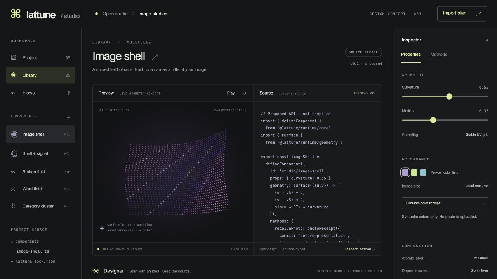

# Studio redesign

**Lattune Studio is a local project workbench for programmable components.** The design concept in `apps/studio-concept` is interactive but scripted. It contains no live agent/compiler/import service.

## Information architecture

The top bar identifies the open project and workspace status. Left navigation contains Project, Library and Flows; Labs is secondary. A project tree shows ordinary source files and recipe provenance. The center workspace presents Preview and Source together. The right inspector exposes Props, State, Methods, Geometry, Appearance, Motion, Accessibility and Performance. Designer is a contextual bottom panel attached to the selected component and source revision.

Replace the current scene/math/TypeScript/image/design-system workshops with views of the same selected definition and instance. A component is a single source artifact, not several unrelated records.

## Primary authoring journey

1. Open a project or create a local scratch workspace; state which source root can be written.
2. Choose a recipe or existing source component. Show public props, methods, dependencies, license and compatibility before import.
3. Edit source or ask Designer. Dictation fills editable text; it never submits by itself.
4. Designer returns a source diff with the base revision and changed contracts/resources. Concurrent changes make the proposal stale, not silently applied.
5. Compile the exact proposal; inspect diagnostics and artifact hash.
6. Run an isolated preview with declared resource grants. Compilation alone never earns a preview/test badge.
7. Run contract/lifecycle checks. Show which checks passed, failed or have not run for that hash.
8. Save a component version or commit project source; request a separate import plan for another project.
9. Review destination paths, dependencies, hashes and conflicts; apply that exact plan. Publication is separate.

## Validation language

Use explicit states: Proposed, Compiled, Previewed, Contract-tested, Saved, Imported, Published. Every evidence badge binds to an exact source/artifact hash. Editing invalidates affected badges. A save is not a publication. A running preview is not proof of accessibility or frame-rate targets.

The concept labels its transitions as simulated review states to avoid implying these services are implemented.

## Component inspector

- **Props/State:** typed values, defaults, current revision and private/transient fields.
- **Methods:** semantic description, input/output schema, side effects, authority, commit policy, invocation controls and receipts.
- **Geometry:** surface/path/composite math and stable cell sampling; raw code remains available.
- **Appearance:** per-cell color/glyph/opacity fields, UV sampling and explicit local resource slots.
- **Motion:** deterministic timing, easing, interruption policy and reduced-motion endpoint.
- **Accessibility:** native content/controls, text fallback, keyboard actions and meaningful motion settings.
- **Performance:** device/workload-specific samples, payload and resource lifecycle. No fabricated FPS.

## Data interaction

A source form submits a typed chunk. Letters travel as presentation; the receiving component's declared method commits state according to its policy and owns organization. Components can discover compatible methods by contract/capability metadata. A directory can show stable IDs, page-local locators and fresh incarnation handles. It cannot grant authority.

For an image surface, a photo resource supplies cell colors; a transition displays the incoming color field across stable cell IDs. The same receive method is available in native controls, agent tools and peer code. After commitment, cancelling the transition preserves the accepted target state.

## Visual direction

Graphite workspace, warm paper contrast in the catalog, restrained acid-lime accents, crisp grids, blue-violet cells and small technical labels. Retain some Berlin techno/Y2K character through geometry and typography; keep editing surfaces readable. Color supports status but never carries it alone. Limit decorative motion around code and forms.

## Accessibility and behavior

Real buttons, forms, labeled controls and native selection precede canvas decoration. Keyboard users can select recipes, inspect contracts and review proposals without dragging. Focus returns to the action that opened a dialog. Dialogs close on Escape. Reduced motion freezes decorative preview motion. Hidden tabs stop animation. The preview has meaningful text describing selected geometry and a live region for explicit user actions. Follow the relevant [WAI-ARIA authoring patterns](https://www.w3.org/WAI/ARIA/apg/patterns/) when custom controls are introduced.

## Other clients

Library consumers need no Studio. CLI and agent users receive the same diagnostics and receipts. Hermes installation optionally adds the Designer's profile and skill; it does not make that identity mandatory or replace an existing profile/provider. A future cloud UI is a separate deployment decision after local source ownership and recovery work.

